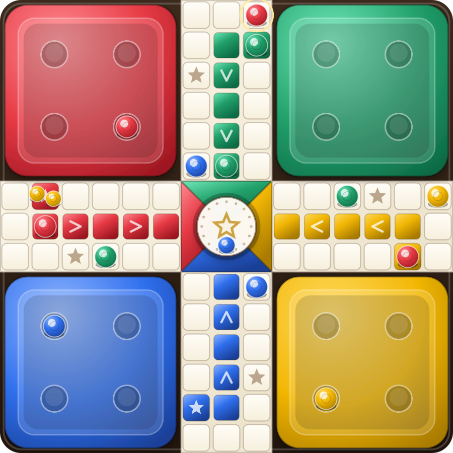

# Ludo Royale 🎲

An original, offline-first **Ludo** game for phones: four-player classic, two-player duels, pass &
play and CPU opponents — built as a mobile-first PWA with a ready-to-build **Android (Capacitor)**
wrapper.

> Clean-room implementation. No code, artwork, audio or branding from Ludo King or any other
> commercial app is used or redistributed. All visuals are drawn with SVG/CSS and all audio is
> synthesised at runtime. "Ludo King" is a trademark of its owner; this project is not affiliated
> with, endorsed by or derived from it.



## Play it

```bash
cd ludo-king
npm install
npm run dev        # http://localhost:5173  (also exposed to your phone via the LAN URL)
```

```bash
npm run build      # static bundle in dist/ — host anywhere, works offline as a PWA
npm test           # 55 automated tests
```

## Features

| Brief item | Status |
| --- | --- |
| 1. Professional Ludo board | ✅ procedural SVG board: recessed cross, yards, 52-square track, star squares, chevrons, crown centre |
| 2. Four-player gameplay | ✅ Red / Green / Yellow / Blue |
| 3. Colour zones | ✅ per-seat yard panels, lane gradients, token materials |
| 4. Dice with realistic animation | ✅ CSS 3D cube, multi-axis tumble, deceleration, settle bounce, six-glow |
| 5. Four tokens per player | ✅ 16 tokens (8 in duel mode) |
| 6. Movement by dice value | ✅ hop-by-hop animation with per-hop audio ticks |
| 7. Safe squares & capture rules | ✅ 8 safe squares, blockades, bonus roll on capture |
| 8. Home entry & winning | ✅ private lanes, exact-roll entry (presets vary), 4-home victory |
| 9. Turn management | ✅ deterministic turn machine, auto-pass on no legal move |
| 10. Local multiplayer | ✅ 1–2 humans on one device, mixed with CPUs |
| 11. Computer AI | ✅ Easy / Medium / Hard heuristic opponents (never cheat) |
| 12. 2-player & 4-player modes | ✅ diagonal duel or full classic |
| 13. Pause, resume, restart | ✅ plus automatic save/restore of the match |
| 14. Result & victory screen | ✅ trophy card, match stats, confetti, rematch |
| 15. Sound & music | ✅ 10 synthesised SFX + generative music loop, independent toggles |
| 16. Smooth animations | ✅ CSS transitions driven by one speed variable; reduced-motion aware |
| 17. Responsive for Android phones | ✅ safe-area insets, `100dvh`, container-sized board, landscape layout |
| 18. Settings & player selection | ✅ sound, music, haptics, speed, difficulty, name, rule presets, stats reset |

Extras: keyboard controls (Space/Enter to roll, 1–4 to pick a move, Esc to pause), lifetime stats,
three rule presets (Classic / Quick Match / Chaos), "Watch" mode (CPU vs CPU demo), share-ready PWA
manifest and icons, zero network requests at runtime.

## Screens

1. **Home** — crest, Play / Continue / How to play / Settings, lifetime stat strip.
2. **New match** — board size (2P/4P), humans (1, 2 or watch), CPU difficulty, rule preset, name.
3. **Match** — player rail with per-token status, board, 3D die + Roll button, live match feed.
4. **Pause overlay** — resume, restart, sound, quit (match saved automatically).
5. **Result** — winner, rolls/captures/turns/tokens-home, rematch / view board / menu.
6. **Settings** and **How to play** — fully written out, no placeholders.

## Project structure

```
ludo-king/
├── index.html                 # app shell (PWA meta, manifest, icons)
├── src/
│   ├── main.ts                # entry: mount app, register service worker
│   ├── core/                  # pure, DOM-free, unit-tested game logic
│   │   ├── types.ts           #   domain types + constants
│   │   ├── geometry.ts        #   15×15 board maths, track, lanes, paths
│   │   ├── rng.ts             #   seeded mulberry32
│   │   ├── engine.ts          #   rules state machine, save/restore
│   │   ├── dice.ts            #   faces, rotations, shake curves
│   │   ├── ai.ts              #   CPU scoring & difficulty
│   │   ├── setup.ts           #   rule presets, seat building
│   │   └── persistence.ts     #   settings, stats, autosave (localStorage)
│   ├── ui/
│   │   ├── app.ts             #   navigation + lifecycle
│   │   ├── game.ts            #   turn loop, HUD, toasts, haptics
│   │   ├── board.ts           #   board SVG + token animation
│   │   ├── dice.ts            #   CSS 3D die
│   │   ├── audio.ts           #   procedural SFX + music
│   │   ├── confetti.ts        #   victory particles
│   │   ├── screens.ts         #   menus, settings, rules, result
│   │   └── dom.ts             #   tiny DOM helpers
│   └── styles/                # design system + match screen
├── tests/                     # 55 Vitest tests (rules, geometry, AI, dice, UI)
├── scripts/
│   ├── crest.mjs              # procedural crest/icon/splash renderer
│   ├── generate-icons.mjs     # PWA icons + favicon
│   ├── generate-android-assets.mjs  # launcher icons + splash screens
│   └── render-preview.ts      # renders the real board to docs/board-preview.svg
├── public/                    # manifest, service worker, generated icons
├── docs/                      # research, architecture, test results, previews
└── android/                   # Capacitor Android project (ready for Gradle)
```

## Android APK

A native Android project already exists in `android/` (Capacitor 7, `tools.ludoroyale.game`). It is
fully offline — **the manifest requests no permissions at all**, and all assets are bundled inside the
APK.

### Option A — build it on GitHub (no local setup)

Push this repository and run the **“Ludo Royale — test, build & package”** workflow
(`.github/workflows/ludo-royale.yml`) from the Actions tab. It runs the tests, builds the web bundle,
assembles `app-debug.apk`, optionally signs a release build if you add these secrets:

| Secret | Meaning |
| --- | --- |
| `ANDROID_KEYSTORE_BASE64` | `base64 -w0 release.keystore` |
| `ANDROID_KEYSTORE_PASSWORD` | keystore password |
| `ANDROID_KEY_ALIAS` | key alias |
| `ANDROID_KEY_PASSWORD` | key password |

Download the APK from the workflow run's **Artifacts** section.

### Option B — build locally

Requires JDK 17+ and the Android SDK (`ANDROID_HOME`), then:

```bash
cd ludo-king
npm install
npm run android:sync     # build web bundle + copy into android/
cd android && ./gradlew assembleDebug
# -> android/app/build/outputs/apk/debug/app-debug.apk
adb install -r app/build/outputs/apk/debug/app-debug.apk
```

For a Play-Store-ready bundle: `./gradlew bundleRelease` (configure signing in
`android/app/build.gradle` or via `-Pandroid.injected.signing.*`).

> This sandbox has no JDK/Android SDK, so the APK itself was not compiled here. The Gradle project,
> manifest, theme, icons and splash screens are generated and verified; compilation happens in CI or
> on your machine.

## Rules implemented

- Roll a **6** to bring a token out; a 6 grants another roll; **three sixes in a row forfeits the turn**.
- Landing on an opponent sends it home and grants a **bonus roll**.
- **Safe squares**: the four coloured start squares plus four star squares (8 total) — no captures there,
  and several tokens may share them.
- **Blockade**: two of one owner's tokens on a square cannot be attacked (Chaos preset allows it).
- **Home lane** is private; **Classic** requires an exact roll to finish, **Quick Match** clamps.
- No legal move ⇒ the turn passes automatically.
- First player with all four tokens home wins.

Presets: **Classic**, **Quick Match** (no exact home entry), **Chaos** (blockades are capturable).

## Testing

```bash
npm test                 # 55 tests
npm run test:coverage    # 94.4% statements on core/
npm run typecheck        # strict TS, zero errors
npm run icons            # regenerate PWA icons
node scripts/generate-android-assets.mjs
npx vite-node scripts/render-preview.ts   # re-render docs/board-preview.svg
```

Details and per-case evidence: [`docs/TEST-RESULTS.md`](docs/TEST-RESULTS.md).

## Documentation

| Document | Contents |
| --- | --- |
| [`docs/PHASE1-RESEARCH.md`](docs/PHASE1-RESEARCH.md) | REA installation report, `rea doctor` output, missing dependencies, public-source feature/rule research with citations |
| [`docs/PHASE2-ARCHITECTURE.md`](docs/PHASE2-ARCHITECTURE.md) | Stack choice, layers, state model, rules encoding, turn loop, responsiveness, test strategy |
| [`docs/TEST-RESULTS.md`](docs/TEST-RESULTS.md) | Every test case, coverage table, what is not covered |

## Known limitations

1. **No APK was compiled in this sandbox** (no JDK/Android SDK); use the CI workflow or a local Gradle
   build. The native project itself is complete and generated.
2. **No automated browser/device testing.** Rendering was verified by rasterising the board component
   to SVG/PNG; the 3D dice, Web Audio and vibration need a real browser to hear/see.
3. **Local only.** No online multiplayer, accounts, chat, coins, themes or tournaments — deliberately
   out of scope (and out of the legal bounds set for this task).
4. **Not a Ludo King clone.** No Ludo King screenshots, APK or recordings were available, so its
   exact UI, timings, audio and AI are unknown here; the layout is an original design, and the
   Phase 1 report lists what could not be verified. Provide an APK + a JADX MCP JAR and a JDK if you
   want a static comparison.
5. **Three-player mode** is not exposed in the UI (the engine supports 2–4 seats; only 2 and 4 are
   wired to the menus, matching the brief).
6. AI is heuristic (no search), so "Hard" is strong-but-beatable rather than optimal.
7. Music is a single generative loop; there are no per-theme tracks.
8. Saves live in `localStorage` — clearing site data or reinstalling the app discards the saved match.
